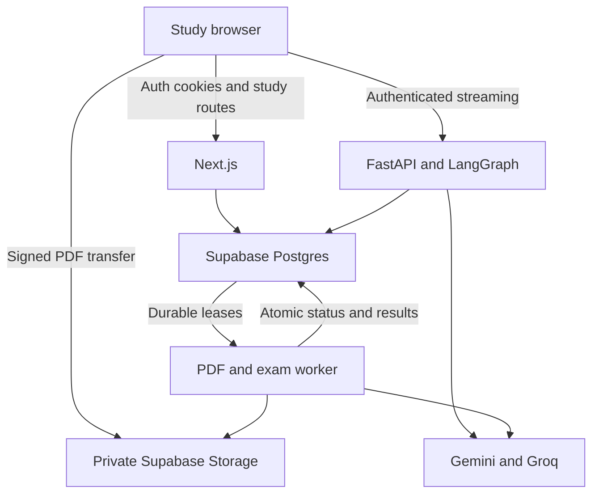

# Socra Backend (Python · FastAPI · LangGraph)

Multi-agent Socratic tutoring backend that powers the Next.js Socra frontend.
Orchestrates four agents (**Diagnostiqueur**, **Tuteur Socratique**,
**Évaluateur**, **Mémoire**) with LangGraph and streams answers over
WebSocket.

> Scope: see `../scope2.md`.

## Status

Phases implemented:

| Phase | Description                                                                  | Status |
| ----- | ---------------------------------------------------------------------------- | ------ |
| 1     | Python project setup, FastAPI skeleton, Supabase client + DB modules         | done   |
| 1.3   | New tables `student_profiles` + `diagnostics` (with RLS) applied via MCP     | done   |
| 2     | RAG layer (Gemini embeddings + pgvector retriever)                           | done   |
| 3     | LangGraph state contracts + orchestrator + conditional edges                 | done   |
| 4     | Agent **Diagnostiqueur** — Gemini chain + JSON parser + RAG + persistence    | done   |
| 5     | Agent **Tuteur Socratique** — streaming, RAG-grounded, profile-aware         | done   |
| 6     | Agent **Évaluateur** — key terms + suggested readings + comprehension score  | done   |
| 7     | Agent **Mémoire** — deterministic profile updates persisted to Supabase      | done   |
| 9     | FastAPI WebSocket endpoint `/ws/chat/{session_id}` with token streaming      | done   |
| 10    | Next.js study pages use the FastAPI WebSocket                             | done |
| —     | Re-embed existing chunks with `gemini-embedding-001` + fix `/api/upload`     | not yet |

## Requirements

- Python 3.12 (managed via [`uv`](https://github.com/astral-sh/uv))
- A Supabase project with the V1 schema + the two new tables (already applied)
- A Gemini API key

## Setup

```bash
cd socra-backend
cp .env.example .env   # fill in your keys
uv sync
```

## Run

```bash
uv run uvicorn main:app --reload --port 8000
```

Endpoints:

- `GET /health` — liveness + agent inventory
- `GET /docs`   — OpenAPI / Swagger UI

## Smoke tests

```bash
# RAG: embed a query and retrieve top-K chunks from a real course
uv run python scripts/smoke_rag.py

# Full LangGraph: Diagnostiqueur → Tuteur → Évaluateur → Mémoire (no streaming)
uv run python scripts/smoke_graph.py

# WebSocket end-to-end: connect, send 2 turns, verify streaming + context panel.
# Requires the server to be running first (see below).
uv run python scripts/smoke_ws.py
```

## Hosted Explainer and Notebook settings

On Render, add these values in **socra-backend → Environment**:

```dotenv
EXPLAIN_FIRST_FIVE_QCM=1
EXPLAIN_COURSE_LESSONS=1
EXPLAIN_SPARK_REPORT=1
```

To pin the two document-generation models, optionally set `SOCRA_CHAPTER_MODEL`
and `SOCRA_SPARK_MODEL` to `gemini-3.5-flash-lite`. Leave
`EXPLAIN_SCOPED_SOURCES` unset for ordinary use. It enables a diagnostic scope
report for requests outside the dedicated generation routes.

The Render Blueprint uses the repository root and installs the locked Node
dependencies so the API can extract the original PDFs. If managing the service
directly in Render Settings, clear **Root Directory** and copy the Build and
Start Commands from `render.yaml`. Use **Save only** for environment changes
until the new build is ready to deploy.

For Notebook screenshots, add `NOTEBOOK_IMAGE_UPLOADS=1` in the Next.js project's
**Vercel → Settings → Environment Variables → Production** and redeploy. Its
Supabase project needs the private `notebook-images` bucket with authenticated
owner-folder read access.

## WebSocket protocol

For a frontend at `http://localhost:3000`, connect to `ws://127.0.0.1:8000/ws/chat/{session_id}`. The separate hostname keeps frontend cookies out of the WebSocket handshake.

**Client → server** (one frame per student message):

```json
{ "message": "I want to learn about star schemas.", "courseId": "<uuid>", "sessionId": "<uuid>" }
```

**Server → client** (multiple frames per turn):

```json
{ "type": "diagnostic", "content": { ...DiagnosticReport } }   // first turn only
{ "type": "token",      "content": "<partial assistant text>" } // many
{ "type": "context",    "content": { ...EvaluationResult } }    // when Évaluateur ran
{ "type": "done" }                                              // always — turn finished
{ "type": "error",      "content": "<message>" }                // on failure
```

## Layout

```
socra-backend/
├── main.py                   FastAPI entry point
├── config.py                 Env-backed Settings (Pydantic)
├── pyproject.toml / uv.lock
├── api/                      HTTP & WebSocket routes
│   ├── routes/health.py
│   └── websocket.py          Phase 9 — /ws/chat/{session_id}
├── agents/                   The 4 Socra agents (all real)
│   ├── llm.py                Shared Gemini chat-LLM factory (with retries)
│   ├── diagnostiqueur.py     Phase 4
│   ├── tuteur_socratique.py  Phase 5 (streaming + heuristic TutorSignal)
│   ├── evaluateur.py         Phase 6 (silent eval, persists key_terms)
│   └── memoire.py            Phase 7 (deterministic profile updater)
├── prompts/                  System prompts (one file per agent)
│   ├── diagnostiqueur_prompt.py
│   ├── tuteur_socratique_prompt.py
│   ├── evaluateur_prompt.py
│   └── memoire_prompt.py     (constants only — Mémoire is deterministic)
├── graph/                    LangGraph state machine
│   ├── state.py              SocraState + sub-TypedDicts
│   ├── nodes.py              Node functions (real + stubs)
│   └── orchestrator.py       Edge wiring
├── rag/
│   ├── embeddings.py         Gemini gemini-embedding-001 (768 dims)
│   └── retriever.py          Supabase match_embeddings RPC
├── db/
│   ├── supabase_client.py    Service-role client singleton
│   ├── messages.py           Read/write chat history
│   ├── profiles.py           Read/write StudentProfile
│   └── diagnostics.py        Read/write DiagnosticReport
├── models/schemas.py         Pydantic API I/O
└── scripts/                  Manual smoke tests
```

## Important notes

### Model selection and embeddings

Gemini chat defaults to the pinned `gemini-3.5-flash-lite` model. Saved Gemini 2.5 Flash-family preferences and floating Flash aliases resolve to that default, including direct requests and old `CHAT_MODEL` settings. The user's Gemini key is retained. Allowed explicit Gemini and Groq selections continue to take precedence.

Queries and the PDF worker use `gemini-embedding-001` at 768 dimensions, with `RETRIEVAL_QUERY` and `RETRIEVAL_DOCUMENT` respectively. The worker can reuse an index for the same owner's identical PDF and indexing configuration. Older vectors may lack model provenance. If a document is known to have vectors from a retired model, the existing per-document rebuild can regenerate them in the current model's space. It preserves the previous index until the replacement commits.

Google lists May 14, 2028 as the shutdown date for this embedding model. A future switch to `gemini-embedding-2` requires benchmarking and re-embedding the full corpus into a separate index, followed by a coordinated query/index cutover. See [Gemini embedding migration](https://aistudio.google.com/docs/embeddings#migration) and [Gemini deprecations](https://aistudio.google.com/docs/deprecations#embedding-models).

### Why service-role key

The Python backend bypasses RLS so it can write `student_profiles` and
`diagnostics` on behalf of the authenticated user. For reads, the frontend
hits Supabase directly with the user JWT and is restricted by the RLS
policies defined in the migration `add_student_profiles_and_diagnostics`.

## Study request and PDF processing paths

- Inquiry and Diagnostic share the frontend `useSocraChat` hook. FastAPI verifies the Supabase access token, course and inquiry at handshake and action time. It acquires a database lease before reading turn state and releases it after any evaluation and profile update. The UI can send a next turn once the answer is committed. That turn waits for profile finalization before reading history. Retry reuses a request ID and replays a committed response.
- The first Socratic turn uses Diagnostiqueur before Tuteur. The tutor forwards public model deltas and saves the visible answer before Évaluateur and Mémoire finish. Explain streams readable text projected from the actual structured model output, then validates the final card and binds citations to retrieved pages. Practice and correction only publish student-safe fields.
- The Next.js upload route authenticates, verifies course ownership and issues a signed Storage destination. The browser sends the PDF directly to Storage. Finalization verifies the object size and MIME before creating the document and indexing job together. The worker checks actual bytes and SHA-256 before extraction. The worker extracts text, preserves page boundaries and saves it for the summary job. Indexing and summarizing can then run concurrently. Activation replaces vectors in one transaction. If the summary fails, ordinary course-scoped vector retrieval stays available.
- The authenticated exam API queues generation and grading and returns progress during either job. The worker verifies and commits individual questions to their planned slots. The exam opens after all slots are ready. Answer writes reject stale edits, and grading freezes the submitted answers, resumes from committed grades and publishes the score and profile together. Completed solutions are exposed only to the exam owner.
- The worker leases jobs for five minutes and bounds processing at 210 seconds. Failed transient attempts back off. An expired lease is reclaimed, with up to three processing attempts. Lease tokens, document generation and source hash prevent stale writes. Deleting a document cascades its jobs and derived data. Storage cleanup is queued on document removal, including course deletion, and retried by the worker.

### WebSocket protocol 2

Connect to `/ws/chat/{session_id}`. First send `{"action":"authenticate","version":2,"courseId":"<uuid>","accessToken":"<jwt>"}`. After `connected`, send each action with a UUID `requestId`, course/inquiry IDs and current JWT. Keep credentials out of the socket URL. Server action frames carry `version`, `request_id`, `session_id`, `sequence`, and `timestamp`.

| Event | Payload |
| --- | --- |
| `request_accepted` | The server has received a well-formed action |
| `progress` | An actual stage label |
| `content_delta` | Public text. A null Explain delta resets an invalid draft |
| `diagnostic` | Initial study assessment |
| `card_ready` | A validated public exercise, explanation, correction or explicitly revealed solution |
| `response_complete` | Persisted assistant ID and text |
| `context_update` | Evaluation for the completed request. Key terms and verified reading pages are persisted with the assistant response and restored on replay. |
| `turn_finalized` and `done` | Follow-up work and the turn have ended |
| `error` or `cancelled` | The turn failed or stopped before response commit |

`cancel` includes the active request ID. The browser keeps incomplete text visibly partial and can retry the same ID after reconnect or reload. Regenerate starts a new turn. Version 1 clients receive the `token`, `context` and legacy card event names, plus `done`.

### Verification and timings

From `socra-backend`, run `python -m unittest discover -s tests -v`. If a Windows sandbox blocks asyncio's loopback socket, use `python -m tests.offline_windows discover -s tests -v` for offline fixtures. From `socra`, run `npx next typegen` and `npx tsc --noEmit --incremental false` from a clean build output. Set `SOCRA_TEST_BROWSER` to a Chromium executable and run `node scripts/test-chat-browser.mjs` to exercise the production hook with an in-browser fake socket.

`chat_connected` and `chat_timing` report connection, acknowledgement, time before model calls, model duration, first visible text, answer completion, follow-up nodes and total duration. `pdf_upload_timing`, `pdf_timing`, `pdf_embedding_batch` and `pdf_summary_batch` report job/stage durations, attempts, page/chunk/batch counts and provider outcomes. The upload request ID is also the document ID. PDF worker logs include the document ID and the job ID for correlation. Use a disposable course and a representative eight-page text PDF to collect paired warm/cold p50 and p95. Record upload acceptance, vector activation, Course Map completion, and socket opening separately. The local parser fixture measured 218.9 ms p50 and 260.0 ms p95 over 20 launches, including Node startup and chunking. It excluded Storage, providers and the database.

Run `node --test scripts/test-direct-upload.mjs` from `socra` for the signed upload flow and `python -m tests.benchmark_phase_4_6` from `socra-backend` for the offline retrieval and exam concurrency comparison. The benchmark simulates provider and database delay. Use the SQL fixtures and test environment procedure in `DEPLOYMENT.md` for database, Storage and provider verification.

`model_call` logs per-agent provider/model latency, first public text when streaming, available token usage, retry events and estimated cost when rates are configured. `structured_output_rejected` records the attempt and error type. `exam_job` and `exam_generation_progress` include job IDs, durations and verified question counts.

### Phase 5 provider comparison

From `socra-backend`, run this command with network access and keys for the selected providers:

```sh
python -m tests.benchmark_phase_5_models --live --model google:gemini-3.5-flash-lite --model groq:openai/gpt-oss-120b --samples 5
```

The runner supplies synthetic course pages to the real Socratic, Explain, Practice and exam generation/grading agents. It uses provider quota and keeps Supabase out of the run. The output shows pass counts and end-to-end p50/p95 by scenario. Per-call metrics include first text, token usage when available, and estimated cost with configured prices. Use the same sample count for each model and review explanation quality, source grounding and grading before changing defaults or reducing reasoning. The independent exercise verifier remains enabled to check whether the source supports the answer.


## Runtime architecture



Course Context is restored from completed message metadata. Evaluator citations are rebound to retrieved document pages. The client obtains a short-lived Storage redirect only after the API checks document ownership and page bounds. Library and Notebook explanation saves use a persisted assistant message, and conversion from Library opens the editable note.

Shared Postgres limits apply to new model requests, exam queueing and PDF retries. Completed chat replays reuse the saved response without consuming model quota. The worker recognizes scanned pages locally when requested, then uses the normal embedding pipeline. Deleting a document or course records the PDF object for Storage cleanup.

Use `node --test scripts/test-study-routes.mjs` in the frontend for mocked tests of PDF authorization and page redirects, password recovery, and saved explanation ownership. See `DEPLOYMENT.md` for local bootstrap, worker requirements and the hosted acceptance checklist.
